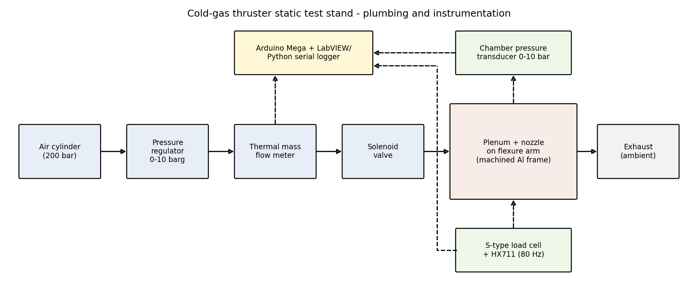
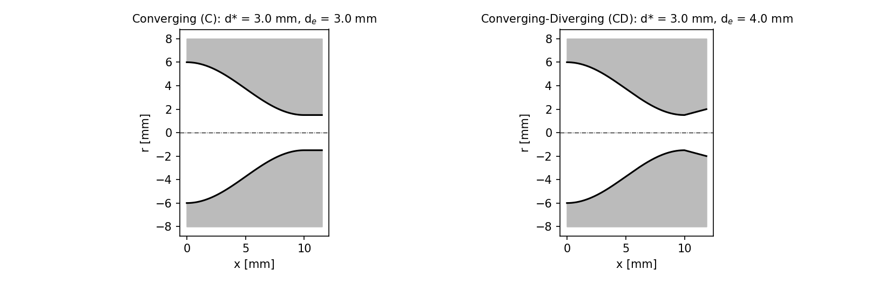
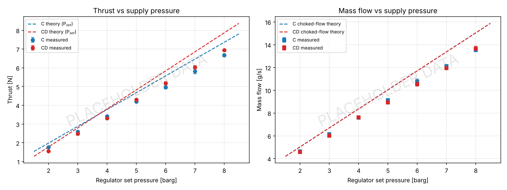
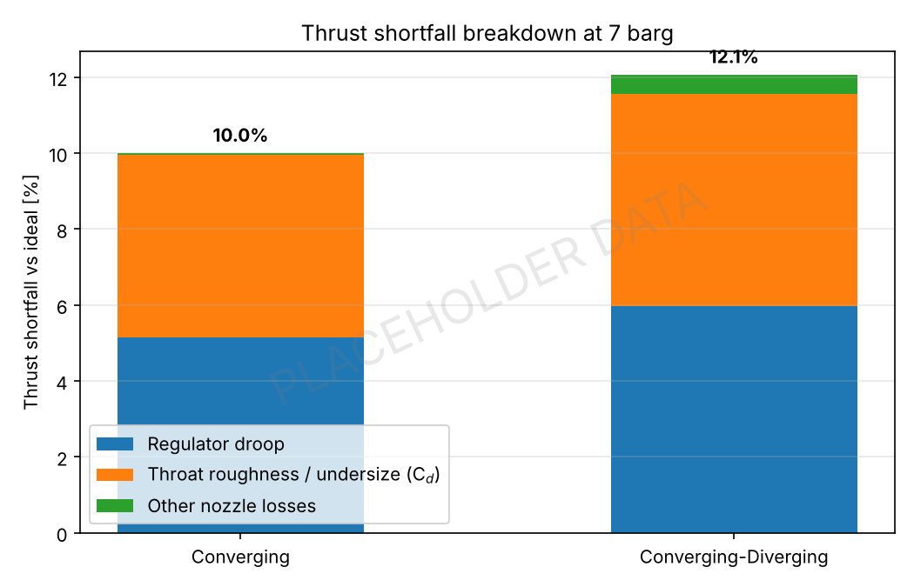
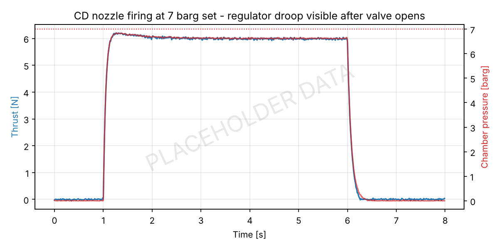
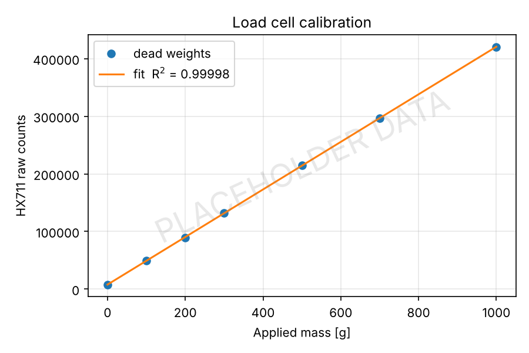

# Cold-Gas Thruster Static Test Stand - Smart India Hackathon SIH2026

**`SolidWorks` `Python` `Compressible Flow` `3D Printing` `Machining` `Instrumentation`**

## Objective
Smart India Hackathon SIH2026 (Aerospace Category). Design and build a static test stand for small cold-gas thrusters and use it to check how well 3D printed nozzles perform against isentropic and choked-flow theory.

## Details
- Designed the thrust stand in SolidWorks with a team of 6 - flexure arm carrying the plenum and nozzle, S-type load cell under the arm, machined aluminium frame with 3D printed mounts and nozzle adapters.
- Instrumented the stand with a chamber pressure transducer, inline thermal mass flow meter and HX711 load cell amplifier, all logged through an Arduino to Python.
- Calibrated the load cell with dead weights before every test session.
- Printed and tested a converging (C) nozzle and a converging-diverging (CD) nozzle, both with a 3.0 mm throat (CD exit 4.0 mm, 15° half-angle).
- Swept regulator set pressure from 2 to 8 barg, 3 runs per point, and compared measured thrust and mass flow with 1D isentropic and choked-flow theory in Python.
- Traced a 12% thrust shortfall at the 7 barg operating point to regulator droop and throat roughness.

## Procedure
1. Calibrate load cell with 0 - 1000 g dead weights, fit counts vs load.
2. Leak check plumbing at 8 barg with valve closed.
3. Set regulator, zero load cell, fire for 5 s with solenoid valve, log chamber pressure, thrust and mass flow.
4. Repeat for 2 - 8 barg in 1 bar steps, 3 runs each, for both nozzles.
5. Measure printed throat diameter with pin gauges and surface roughness after testing.
6. Run `thrust_analysis.py` to reduce the data and compare with theory.

## Files
- `thrust_analysis.py` - data reduction, isentropic / choked-flow theory, shortfall breakdown
- `stand_schematic.py` - plumbing and instrumentation schematic, nozzle profiles
- `data/` - load cell calibration, pressure sweep, firing trace, throat inspection
- `results_summary.txt` - output of the analysis

## Tools Used
SolidWorks, Python (NumPy, Pandas, Matplotlib), Arduino, 3D Printing, Machining

## Results

| Nozzle | P set [barg] | P chamber [barg] | Thrust measured [N] | Thrust ideal [N] | Shortfall |
|--------|------|------|------|------|------|
| C  | 7.0 | 6.63 | 5.82 | 6.47 | 10.0% |
| CD | 7.0 | 6.60 | 6.02 | 6.85 | 12.1% |

- Regulator droop: chamber pressure sags ~0.4 bar below set pressure once the valve opens, worth ~6% of thrust.
- Throat roughness / undersize: measured discharge coefficient of 0.94 for the printed CD throat (Ra ~7 um, throat printed 0.08 mm undersize), worth another ~6%.
- Remaining nozzle losses (divergence, wall friction) are small, < 1%.

