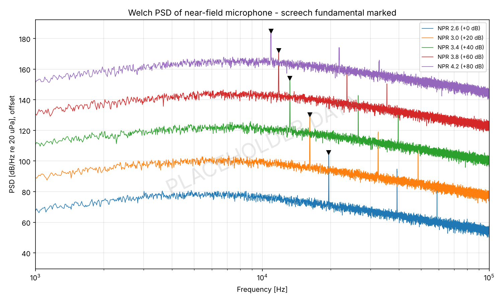
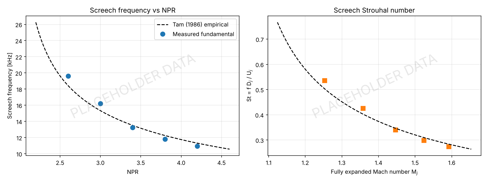
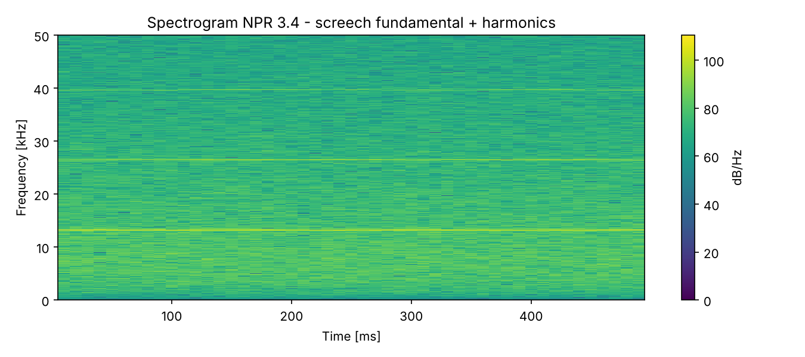

# Supersonic Jet Screech Tone Testing 

**`Python` `LabVIEW` `Aeroacoustics` `Signal Processing` `Compressible Flow`**

## Objective
Identify the screech tone of an underexpanded supersonic jet from high-sample-rate microphone data.

## Details
- Underexpanded jet from a 10 mm converging nozzle run at nozzle pressure ratios (NPR) of 2.6 to 4.2.
- Near-field microphone signal acquired in LabVIEW through an NI DAQ at 204.8 kHz.
- Converted voltage to pressure using the microphone calibration sensitivity.
- Computed Welch power spectral density in Python (Hann window, 16384-point segments, 50% overlap, 12.5 Hz resolution) and picked the screech fundamental as the most prominent narrowband peak above the broadband mixing noise.
- Checked harmonics at 2f and 3f, computed fully expanded jet conditions (Mj, Uj, Dj) and screech Strouhal number, and compared the screech frequency with Tam's empirical model.
- Used a spectrogram to confirm the tone stays steady through each run.

## Procedure
1. Set NPR on the settling chamber, wait for stagnation pressure to settle.
2. Record microphone channel in LabVIEW for each NPR, export to .lvm.
3. Run `screech_psd.py` on the exported files in `data/`.

## Tools Used
LabVIEW, NI DAQ, Python (NumPy, SciPy, Matplotlib)

## Results

| NPR | Mj | Screech f [Hz] | Tam model [Hz] | St |
|-----|----|----|----|----|
| 2.6 | 1.25 | 19627 | 18428 | 0.54 |
| 3.0 | 1.36 | 16198 | 15331 | 0.43 |
| 3.4 | 1.45 | 13236 | 13509 | 0.34 |
| 3.8 | 1.52 | 11803 | 12254 | 0.30 |
| 4.2 | 1.59 | 10932 | 11312 | 0.27 |

- Clear screech fundamental at every NPR with harmonics at exactly 2f and 3f, 30 - 43 dB above the broadband noise.
- Screech frequency drops with NPR as the shock cell spacing grows, within ~6% of Tam's model.

