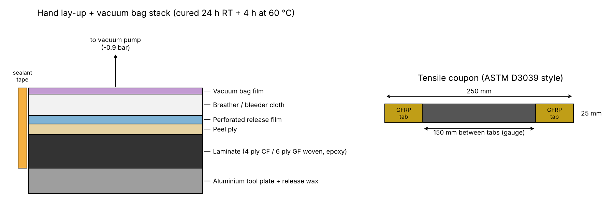

# Composite Laminate Fabrication & Tensile Testing

**`Composites` `Materials Testing` `UTM` `Python` `Vacuum Bagging`**

## Objective
Fabricate carbon and glass fibre laminate coupons by hand lay-up and vacuum bagging at the Materials Science Laboratory, Mahindra University, and compare their tensile properties by testing them to failure on a universal testing machine.

## Details
- Hand laid woven carbon (4 ply, 200 gsm) and woven glass (6 ply, 300 gsm) panels with epoxy on a waxed aluminium tool plate.
- Vacuum bagged the panels with peel ply, perforated release film and breather, cured at room temperature and post cured at 60 °C.
- Calculated fibre weight and volume fraction from dry fabric and cured panel weights.
- Cut 250 x 25 mm coupons with GFRP end tabs, measured width and thickness at 3 points per coupon.
- Tensile tested 5 coupons of each material to failure on the UTM at 2 mm/min.
- Reduced the load-extension data in Python: machine compliance and toe correction, UTS, chord modulus, failure strain, Weibull modulus, failure mode classification.

## Procedure
1. Cut fabric plies, wax tool plate, lay up plies with epoxy and roll out air.
2. Apply peel ply, release film, breather, seal bag and pull vacuum, check for leaks.
3. Cure, demould, weigh panel, cut and tab coupons.
4. Measure coupons, test on UTM at 2 mm/min until failure, export load-extension data.

## Tools Used
Universal Testing Machine, Vacuum pump, Python (NumPy, Pandas, Matplotlib)

## Results

| Laminate | Vf | UTS [MPa] | Modulus [GPa] | Failure strain [%] |
|----------|----|-----------|---------------|--------------------|
| CFRP | 50.5% | 513 ± 21 | 48.2 ± 2.5 | 1.09 ± 0.04 |
| GFRP | 43.9% | 276 ± 4 | 19.1 ± 0.4 | 1.58 ± 0.04 |

- CFRP ~1.9x stronger and ~2.5x stiffer than GFRP, and ~2.2x higher specific strength.
- GFRP fails at higher strain and shows slight non-linearity before failure.
- Most coupons failed in the gauge section (LGM / XGM), one of each material failed at the tab.

