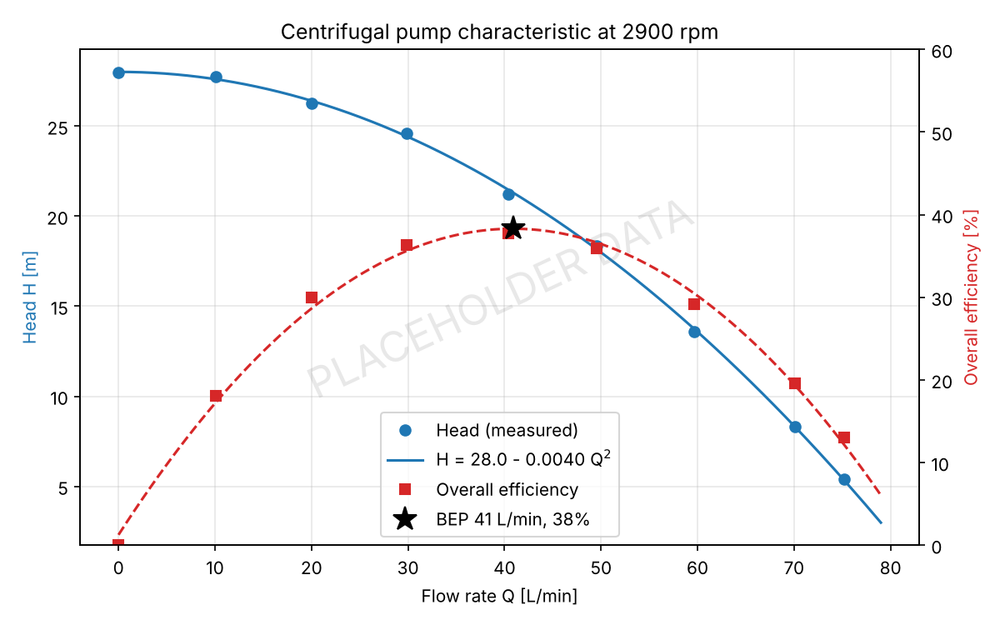
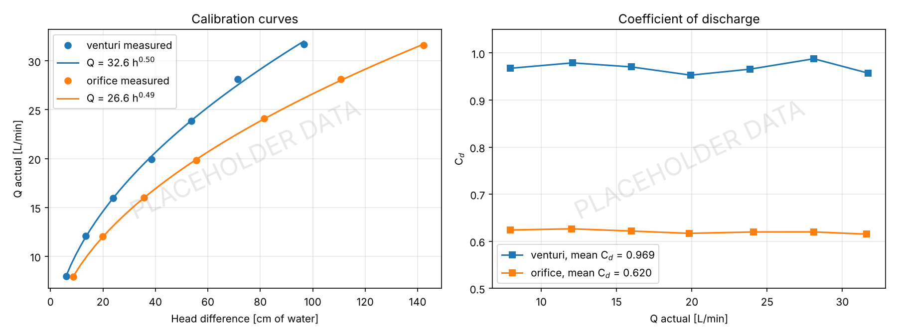
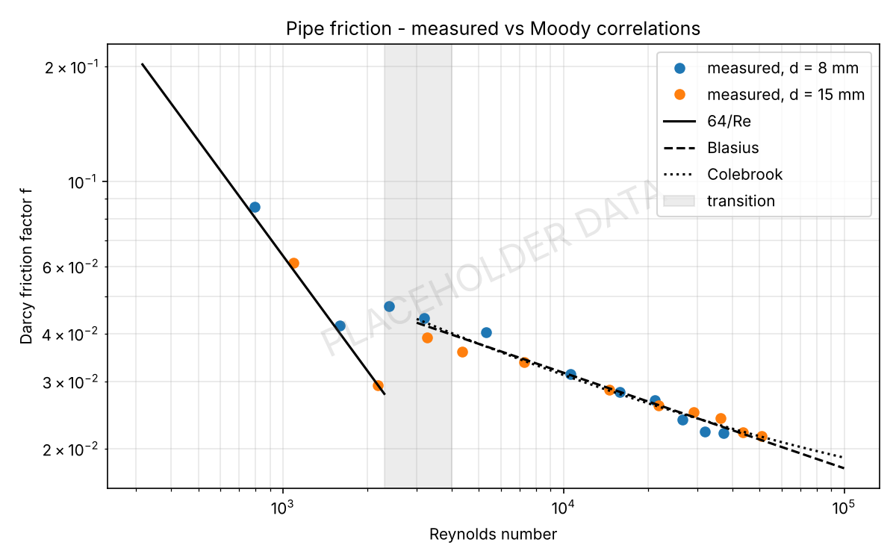
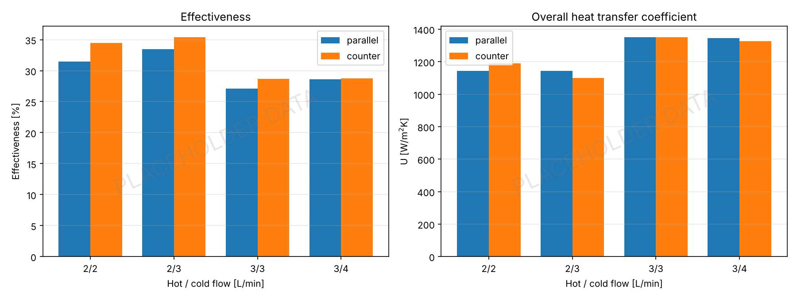
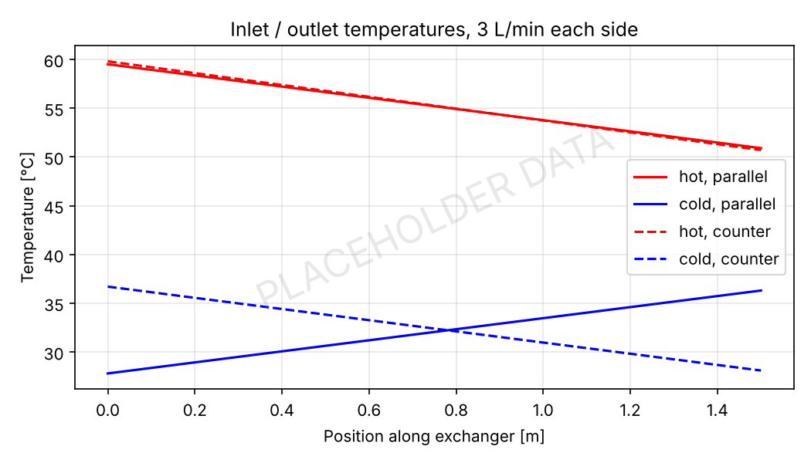
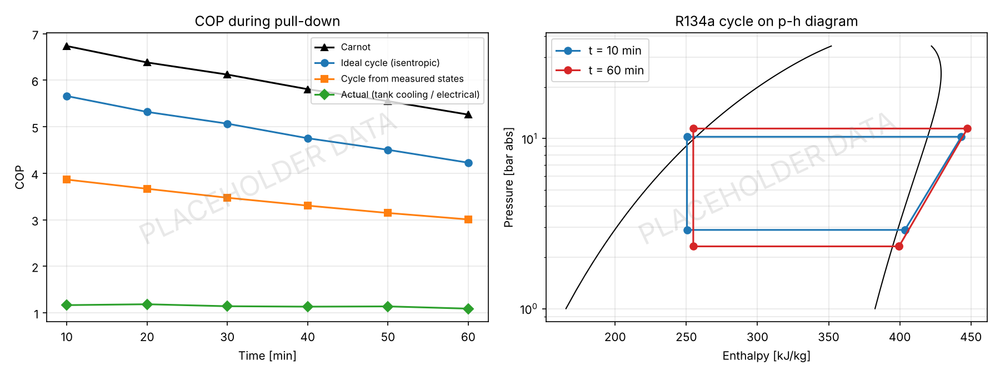

# Thermal & Fluids Laboratories

**`Fluid Mechanics` `Heat Transfer` `Refrigeration` `Python` `Experimental Methods`**

## Objective
Experiments run in the Fluid Mechanics and Workshop Laboratories, Mahindra University (2024 - 2026). Took readings on the lab rigs and wrote up the results in lab reports, then redid the data reduction in Python so all experiments are processed the same way.

## Details
- **Centrifugal pump test** - head, hydraulic power and overall efficiency vs flow at 2900 rpm, curve fit and best efficiency point.
- **Flowmeter calibration** - venturimeter and orificemeter against collecting tank, coefficient of discharge and Q = K h^n calibration.
- **Pipe friction** - Darcy friction factor in 8 mm and 15 mm smooth pipes over laminar, transition and turbulent Re, compared with 64/Re, Blasius and Colebrook.
- **Concentric tube heat exchanger** - parallel and counter flow, energy balance, LMTD, overall U, effectiveness and NTU.
- **Vapour compression refrigeration rig (R134a)** - pull-down test, cycle state points on p-h diagram with CoolProp, actual vs cycle vs Carnot COP, compressor isentropic efficiency.

## Procedure
1. Pump: throttle delivery valve from shut-off to fully open, at each step time 20 L in collecting tank, read suction / delivery gauges and energy meter.
2. Flowmeters: set flow, read mercury manometer across meter, time 10 L in tank.
3. Pipe friction: set flow, read water manometer across 1 m test length, time collected volume.
4. Heat exchanger: set hot / cold flow rates, wait for steady state, record 4 thermocouples, repeat in parallel and counter flow.
5. Refrigeration: start compressor, every 10 min record evaporator / condenser pressure, 3 refrigerant temperatures, evaporator tank water temperature and compressor power.
6. `python run_all.py` processes every experiment.

## Files
- `pump_curve.py`, `flowmeter_calibration.py`, `pipe_friction.py`, `heat_exchanger.py`, `refrigeration_cop.py` - one script per experiment
- `labutils.py` - shared constants and helpers, `run_all.py` - runs everything
- `data/` - readings, `results/` - output tables for each experiment

## Tools Used
Python (NumPy, Pandas, Matplotlib, CoolProp), lab test rigs

## Results

| Experiment | Key result |
|------------|-----------|
| Centrifugal pump | Shut-off head 28 m, BEP 41 L/min at 21 m, overall η 38% |
| Venturimeter | Cd = 0.97 |
| Orificemeter | Cd = 0.62 |
| Pipe friction | Measured f within ~4% of 64/Re and Colebrook outside transition |
| Heat exchanger | Counter flow effectiveness 32% vs 30% parallel at the same flow rates |
| Refrigeration | Actual COP 1.14, cycle COP 3.4, Carnot 6.0 |

